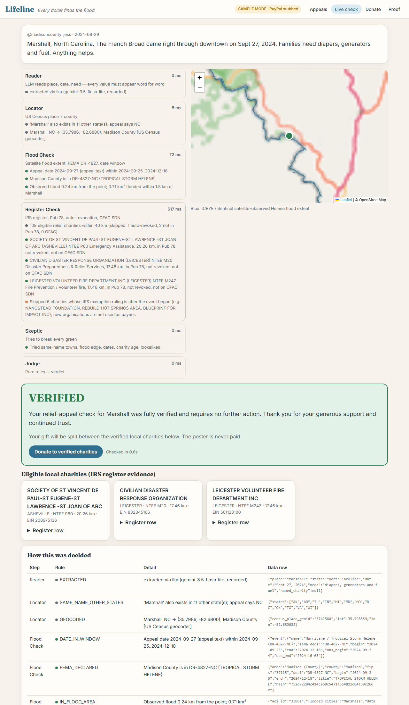
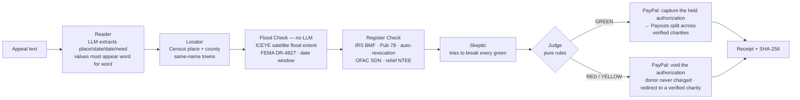
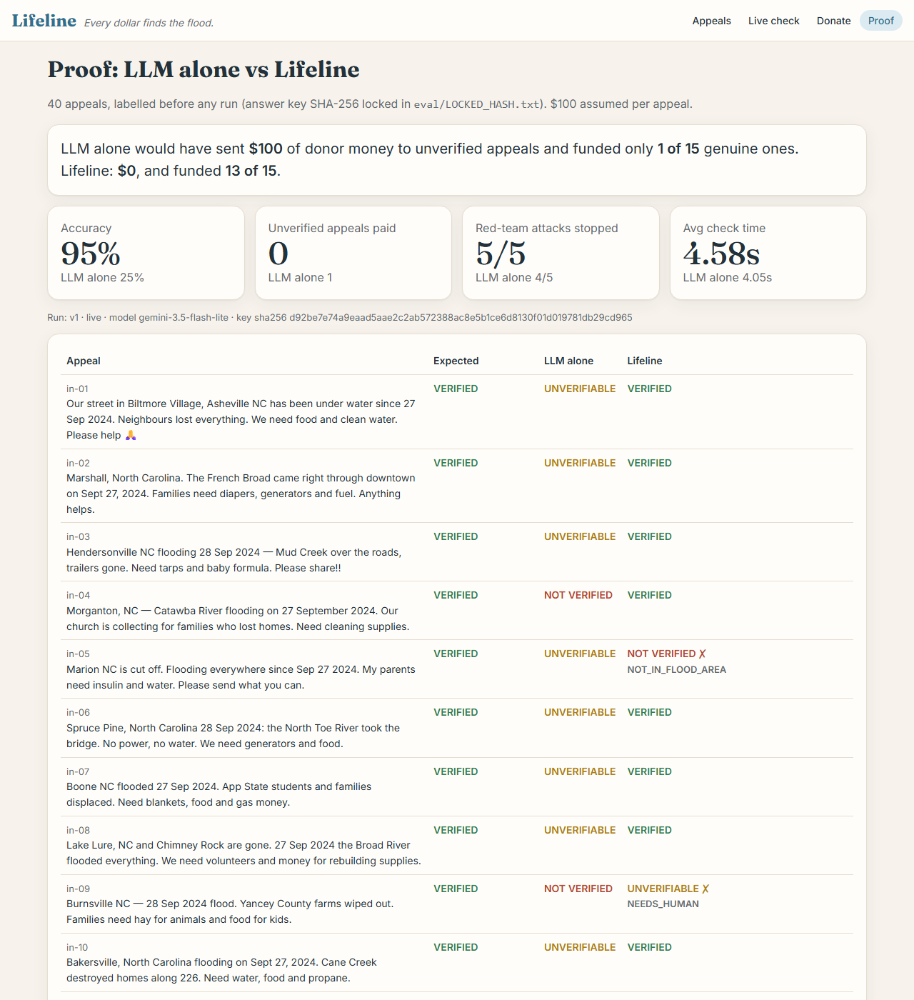

# Lifeline — *Every dollar finds the flood.*

**Problem:** after every disaster, social media fills with "our town is flooded, please send money" appeals. Donors can't tell which are real, and money sent to a stranger's PayPal can vanish.

**Lifeline** checks every appeal against real satellite flood maps. PayPal then pays **only verified, registered local charities** in the flooded area, never the stranger who posted it.



## How it works



| Verdict | Meaning | Reason codes |
|---|---|---|
| 🟢 **VERIFIED** | flooded place + eligible local charities found | — |
| 🔴 **NOT VERIFIED** | a hard check failed | `NOT_IN_FLOOD_AREA` `DATE_MISMATCH` `NO_DISASTER_DECLARATION` `PROMPT_INJECTION` |
| 🟡 **UNVERIFIABLE** | doubt; needs a human | `AMBIGUOUS_PLACE` `EDGE_OF_FLOOD` `NO_ELIGIBLE_CHARITY_NEARBY` `NEEDS_HUMAN` |

Every verdict and receipt carries a SHA-256 of its inputs and evidence. `python verify.py` re-derives them all offline.

### The money (PayPal sandbox)
1. The donor clicks a real **PayPal JS SDK** button. **Orders v2, `intent: AUTHORIZE`**: the money is *held*, not taken.
2. **GREEN:** capture the authorization, then **PayPal Payouts** splits it evenly (to the cent) across up to 3 verified local charities. Each one maps to a clearly labelled **SANDBOX DEMO RECEIVER**.
3. **RED, or YELLOW without human approval:** **void** the authorization, so the donor is never charged. Lifeline suggests a verified charity where the flood actually is: *redirect, don't just block.*
4. The receipt shows who got how much, the IRS register row and the satellite evidence behind each payout.

## Results (40 appeals, locked answer key)

| | LLM alone | Lifeline |
|---|---|---|
| Accuracy | 25% | **95%** |
| Unverified appeals paid | 1 ($100) | **0 ($0)** |
| Genuine appeals funded (of 15) | 1 | **13** |
| Red-team attacks stopped | 4/5 | **5/5** |
| Avg check time | 4.1 s | 4.6 s |

**The LLM alone would have sent $100 of donor money to unverified appeals. Lifeline: $0.** The LLM approved the lookalike-charity attack, and it funded only 1 of 15 real appeals. Lifeline had two honest misses, both of which held money rather than losing it. Full details, misses and the before/after table: [eval/RESULTS.md](eval/RESULTS.md).



## Run it

```bash
pip install -r requirements.txt
python run.py --sample      # FAST JUDGE MODE: offline, no keys, <5 s, prints the scoreboard
python verify.py            # re-derives every verdict and receipt hash
python -m pytest            # 37 tests: every rule + the payment flow
python run.py               # web app on http://localhost:8000 (copy .env.example to .env first)
```

Other entry points: `python run.py --eval --tag v2` (live eval) and `python scripts/build_data.py` (rebuild the store from `data/raw`). Try a check directly: `http://localhost:8000/?appeal=in-02#check`.

**LLM providers:** Gemini, Anthropic, OpenAI or NVIDIA, through one adapter (`lifeline/llm.py`). Model names are pinned in `lifeline/config.py`. Every call has a timeout, one retry and a fallback (deterministic extractor or recorded response), so a check never hangs. Every step is logged to `trace/trace.jsonl`.

## Data sources
Real data, cached offline (see [data/SOURCES.md](data/SOURCES.md)): **ICEYE FSD-2227 Hurricane Helene observed flood extent** (SAR + Sentinel-1/2), **FEMA OpenFEMA DR-4827-NC**, **IRS EO BMF (NC)**, **IRS Pub 78**, **IRS auto-revocation list**, **OFAC SDN**, **US Census Gazetteer + Geocoder**.

**Relief NTEE codes accepted:** M20 Disaster Preparedness & Relief · M23 Search & Rescue · M24 Volunteer fire · M99 Public Safety/Disaster N.E.C. · P60 Emergency Assistance · P20 Human Service Orgs · L41 Homeless Shelters · K30 Food Programs · K31 Food Banks & Pantries · K34 Congregate Meals.

Charity eligibility rules: present in Pub 78, not on the auto-revocation list (or reinstated), not an OFAC SDN name (exact, or fuzzy ≥95), within 40 km, and IRS ruling date before the event. Organisations formed after the storm are skipped as payees.

## Honest limitations
- **We don't verify the poster's identity.** That is exactly why we never pay them.
- **"Revoked" means "not currently eligible"**, not wrongdoing. Most revocations are small groups that missed three years of filings.
- **Synthetic appeals, real places, real flood data.** The 40 appeals were written for testing; the towns, the flood polygons, FEMA, IRS and OFAC data are real.
- **Place = Census centre point + a radius** (1–5 km from land area). Genuine appeals about flooding at a town's edge can be refused (Marion, in the eval). Street-level addresses would fix this.
- **Charity location = ZIP centroid** from the BMF address, not the service area.
- **One event** (Helene, western NC). New events need a new flood extent and declaration.
- **Sandbox only.** Payouts go to labelled demo receivers. Payouts need a US sandbox business account.
- The wording is deliberate: the product never calls an appeal anything but "not verified", with the reason.

## Deploy on Render
`render.yaml` is included: New → Blueprint → pick this repo → fill `LLM_API_KEY`, `PAYPAL_CLIENT_ID`, `PAYPAL_CLIENT_SECRET` → Apply.

## Postman
`postman/Lifeline.postman_collection.json` covers health, check (verified / not verified / injection / streamed), PayPal order, settle, receipt and proof.

---
Built with Cursor and Claude Code. MIT License.
